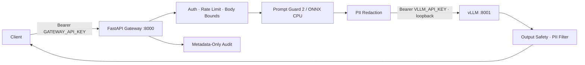

# Secure LLM Deploy

> **⚠️ EXPERIMENTAL / RESEARCH PREVIEW**
> This is a research prototype: not production-ready, not horizontally scalable, and not supported for operational use. Its per-process rate limiter, single-GPU architecture, and in-memory coordination do not scale beyond one node. Security controls are complementary screening layers, not certified safeguards. Use for evaluation, benchmarking, and research only.

A security-hardened vLLM inference gateway: **+57.6% throughput on NVIDIA T4** via EAGLE 3.1 speculative decoding, CPU-only prompt screening (0–2.7% FPR), streaming PII redaction, and zero-trust container security.

---

## Architecture



The gateway is the sole trust boundary. vLLM binds only to `127.0.0.1:8001` and is never exposed externally.

---

## Benchmarks (NVIDIA T4)

**Models used:** The target model is [`Qwen/Qwen3-8B`](https://huggingface.co/Qwen/Qwen3-8B), served in AWQ-quantized form as [`Qwen/Qwen3-8B-AWQ`](https://huggingface.co/Qwen/Qwen3-8B-AWQ) to fit the T4. Speculative decoding uses the EAGLE 3.1 speculator [`RedHatAI/Qwen3-8B-speculator.eagle3`](https://huggingface.co/RedHatAI/Qwen3-8B-speculator.eagle3), with the method from [`SafeAILab/EAGLE`](https://github.com/SafeAILab/EAGLE). Prompt screening uses [`meta/Llama-Prompt-Guard-2-22M-onnx`](https://huggingface.co/meta/Llama-Prompt-Guard-2-22M-onnx), a QUInt8 ONNX model that runs on CPU only. Deployed revisions are pinned by immutable commit in [`image/model.lock`](image/model.lock).

**Environment:** vLLM 0.31.0 · Tesla T4 (14.56 GiB) · PyTorch 2.13.0+cu132 · 8 prompts × 128 tokens × 3 trials · `temperature=0.0` · `seed=42`
**Full results:** [`evals/llm/eagle_31_t4_results.json`](evals/llm/eagle_31_t4_results.json) · [`evals/llm/eagle31_t4_summary.json`](evals/llm/eagle31_t4_summary.json)

| Configuration | Median Throughput | Speedup | Draft Acceptance | Mean Acceptance Length |
|:---|---:|---:|---:|---:|
| Baseline (autoregressive) | 35.99 tok/s | — | — | — |
| **EAGLE 3.1 (k=2)** | **56.71 tok/s** | **+57.56%** | 47.71% | 1.95 |
| EAGLE 3.1 (k=3) | 52.66 tok/s | +46.29% | 37.55% | 2.13 |

**Token fidelity:** 96.39% token-position agreement vs baseline. The single divergence is attributable to a BF16→FP16 cast on T4 (CC 7.5), not a correctness defect.

**Verdict:** k=2 is optimal on T4-class hardware. k=3 increases acceptance length by only +0.18 tokens while dropping acceptance rate by 10pp, producing a net throughput penalty.

---

## Prompt Guard Evaluation

**Model:** [`meta/Llama-Prompt-Guard-2-22M-onnx`](https://huggingface.co/meta/Llama-Prompt-Guard-2-22M-onnx) · **Suite:** [Horizon Labs Prompt Injection Eval](https://huggingface.co/datasets/Horizon-Labs/prompt-injection-eval-suite)
**Full results:** [`evals/gaurd/results/metrics.json`](evals/gaurd/results/metrics.json) · [`evals/gaurd/results/metrics.csv`](evals/gaurd/results/metrics.csv)

| Dataset | Samples | FPR | Recall | ROC AUC |
|:---|---:|---:|---:|---:|
| jackhhao_test | 262 | 0.0% | 89.9% | 0.996 |
| slabs_test | 2,101 | 2.7% | 38.0% | 0.868 |
| neuralchemy_test | 942 | 1.8% | 46.2% | 0.811 |
| deepset_test | 116 | 0.0% | 10.0% | 0.821 |
| agentic5k_test | 545 | 8.7% | 19.3% | 0.682 |
| bipia | 3,178 | 0.0% | 2.3% | 0.650 |
| piarena | 1,500 | 0.0% | 1.6% | 0.775 |

**Why CPU?** Published workload analysis shows ~83% GPU / ~5% CPU utilization during inference ([Applied Sciences, 2026](https://www.mdpi.com/2076-3417/16/7/3129)). The 22M-parameter ONNX guard (~90 MB) uses idle CPU capacity, preserving all GPU VRAM for KV cache.

**Deployment role:** Low FPR (0–2.7%) makes blocking safe; variable recall (1.6–89.9%) means it is complementary, not sufficient alone. Default policy is fail-closed (`GUARD_FAILURE_POLICY=closed`).

---

## Security Posture

| Control | Implementation |
|:---|:---|
| Authentication | Constant-time Bearer comparison; distinct gateway/internal keys (≥32 chars) |
| Request bounding | ASGI-level body enforcement; Pydantic `extra="forbid"` |
| Rate limiting | Sliding-window per client IP; max 10K tracked clients |
| Prompt screening | CPU-only ONNX; fail-closed; rejects partial scans |
| PII redaction | Local regex + configured secrets; input and streaming output |
| Output safety | Structural validation; tool-call rejection; cross-chunk PII holdback |
| Audit | Metadata-only JSON; no prompt/completion/auth content logged |
| Container | Non-root (UID 2000); read-only artifacts; offline model loading |
| Supply chain | Digest-pinned base image; `uv.lock`; `model.lock` immutable revisions |

**Explicit limitations:** The guard produces false negatives. PII redaction is pattern-based. The rate limiter is per-process. TLS, secret rotation, and network segmentation are deployment responsibilities.

---

## Quick Start

Run all commands from the repository root.

```bash
# Build
docker buildx build --platform linux/amd64 --load \
  --file image/Dockerfile --tag secure-llm-deploy:local .

# Configure (generates two distinct random keys; never commit this file)
cat > .env.local <<EOF
GATEWAY_API_KEY=$(openssl rand -base64 48)
VLLM_API_KEY=$(openssl rand -base64 48)
SERVE_MODE=speculative
EOF
chmod 600 .env.local

# Run (gateway bound to loopback only)
docker run --rm --gpus all --env-file .env.local \
  -p 127.0.0.1:8000:8000 --name secure-llm-deploy secure-llm-deploy:local
```

**Smoke tests:** `SERVE_MODE=both bash ./evals/llm/smoke-tests.sh`

---

## Upstream Documentation

- [vLLM Docker deployment](https://docs.vllm.ai/en/v0.31.0/deployment/docker/)
- [vLLM speculative decoding](https://docs.vllm.ai/en/v0.31.0/examples/features/speculative_decoding/)
- [EAGLE official implementation](https://github.com/SafeAILab/EAGLE)
- [NVIDIA NeMo EAGLE training recipe](https://docs.nvidia.com/nemo/automodel/recipes-e2e-examples/eagle-speculative-decoding)
