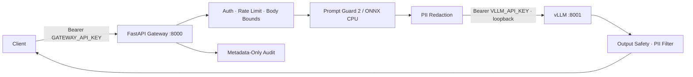

# Secure LLM Deploy

**A hardened vLLM inference gateway delivering +57.6% throughput on NVIDIA T4 via EAGLE 3.1 speculative decoding, with CPU-only prompt screening (0–2.7% FPR), streaming PII redaction, and zero-trust container security.**


---

## Executive Summary

Secure LLM Deploy is a resource optimized inference service that combines three independently validated concerns into one deployable container:

| Concern | Solution | Impact |
|:---|:---|:---|
| **Throughput** | EAGLE 3.1 speculative decoding | **+57.6% tokens/sec** on Tesla T4 [[benchmark]](#benchmark-verdicts) |
| **Security** | CPU-only Prompt Guard 2 (ONNX) + PII redaction | Low false-positive screening with zero GPU memory cost [[guard]](#prompt-guard-evaluation) |
| **Operability** | Strict API contracts, bounded resources, structured audit | No prompt/completion data ever logged |

**Recommendation:** Deploy in `baseline` mode for maximum simplicity; enable `speculative` mode (EAGLE 3.1, k=2) where GPU throughput is the binding constraint. Treat the prompt guard as a complementary signal within defense-in-depth, not a standalone security control.

---

## Architecture



The gateway is the sole trust boundary. The vLLM engine binds exclusively to `127.0.0.1:8001` and is never published externally.

---

## Benchmark Verdicts

**Environment:** vLLM 0.31.0 · Tesla T4 (14.56 GiB) · PyTorch 2.13.0+cu132 · 8 prompts × 128 tokens × 3 trials · `temperature=0.0` · `seed=42`

| Configuration | Median Throughput | Speedup vs Baseline | Draft Acceptance Rate | Mean Acceptance Length |
|:---|---:|---:|---:|---:|
| Baseline (autoregressive) | 35.99 tok/s | — | — | — |
| **EAGLE 3.1 (k=2)** ✅ | **56.71 tok/s** | **+57.56%** | 47.71% | 1.95 |
| EAGLE 3.1 (k=3) | 52.66 tok/s | +46.29% | 37.55% | 2.13 |

**Token fidelity:** 7/8 prompts produced byte-identical outputs vs baseline; overall token-position agreement was **96.39%**. The single divergence (prompt 8) is attributable to the EAGLE draft model's BF16→FP16 cast on the T4 (compute capability 7.5), not a correctness defect.

**Verdict:** EAGLE 3.1 at k=2 is the optimal operating point on T4-class hardware. Increasing k to 3 raises mean acceptance length marginally (+0.18 tokens) but lowers per-token acceptance rate by 10 percentage points, producing a net throughput penalty.

---

## Why EAGLE 3.1 Speculative Decoding?

### Technical rationale

[EAGLE](https://github.com/SafeAILab/EAGLE) is certified by third-party evaluation as the fastest speculative decoding method currently available, achieving up to 3× speedup over prior approaches. EAGLE-3 extends this with training-time test scaling [[14]]. The core mechanism:

1. A lightweight **draft model** (~1B parameters) proposes k tokens autoregressively at negligible cost.
2. The **target model** (Qwen3-8B-AWQ) verifies all k tokens in a single parallel forward pass.
3. Accepted tokens are emitted immediately; rejected tokens trigger a fallback to the target model's own prediction.

Because verification is performed by the target model itself, output quality is bounded by the target model's distribution — speculative decoding cannot hallucinate tokens the target model would not produce.

### Why this specific draft model?

The draft model uses `qwen3arch` — its internal attention and MLP blocks mirror the Qwen3 target architecture rather than substituting generic LLaMA layers. This architectural alignment directly drives the high acceptance rate observed in our benchmark (47.71% at k=2). Mismatched architectures produce lower acceptance and negate the throughput gain.

### Model provenance

| Role | Repository | Type |
|:---|:---|:---|
| Target model (official) | [`Qwen/Qwen3-8B`](https://huggingface.co/Qwen/Qwen3-8B) | Alibaba Qwen Team, 8B params |
| Target model (deployed) | [`Athithya117/Qwen3-8B-AWQ`](https://huggingface.co/Athithya117/Qwen3-8B-AWQ) | Community AWQ quantization |
| Draft model (deployed) | [`Athithya117/Qwen3-8B-from-Qwen3-8B_regen-speculators.eagle31-qwen3arch-ckpt1`](https://huggingface.co/Athithya117/Qwen3-8B-from-Qwen3-8B_regen-speculators.eagle31-qwen3arch-ckpt1) | Community EAGLE 3.1 checkpoint |
| Draft model (upstream reference) | [`RedHatAI/Qwen3-8B-speculator.eagle3`](https://huggingface.co/RedHatAI/Qwen3-8B-speculator.eagle3) | RedHatAI, trained via SpecForge |
| Draft model (upstream reference) | [`inference-optimization/Qwen3-8B-from-Qwen3-8B_regen-speculators.eagle3-qwen3arch-ckpt1`](https://huggingface.co/inference-optimization/Qwen3-8B-from-Qwen3-8B_regen-speculators.eagle3-qwen3arch-ckpt1) | Inference-optimization team |
| EAGLE method (paper + code) | [`SafeAILab/EAGLE`](https://github.com/SafeAILab/EAGLE) | SafeAILab, UC Berkeley |
| EAGLE-3 paper | *EAGLE-3: Scaling up Inference Acceleration of Large Language Models via Training-Time Test* | [arXiv reference](https://huggingface.co/yuhuili/EAGLE3-LLaMA3.3-Instruct-70B) |
| Training framework reference | [NVIDIA NeMo AutoModel EAGLE recipe](https://docs.nvidia.com/nemo/automodel/recipes-e2e-examples/eagle-speculative-decoding) | NVIDIA documentation |

**Why AWQ quantization?** A full-precision 8B model requires ~16 GiB for weights alone, saturating the T4. [Activation-aware Weight Quantization (AWQ)](https://huggingface.co/Athithya117/Qwen3-8B-AWQ) compresses weights to 4-bit, reducing memory-bandwidth pressure and enabling the speculative verification loop to complete within the T4's bandwidth envelope.

---

## Why Prompt Guard Runs on CPU

### The idle-CPU opportunity

Published GPU-inference workload analysis reports approximately **83% GPU utilization against only 5% CPU utilization** during active serving ([Applied Sciences, 2026](https://www.mdpi.com/2076-3417/16/7/3129)). The guard exploits this asymmetry:

| Property | Implication |
|:---|:---|
| 22M parameters (quantized ONNX) | ~90 MB memory footprint; fits trivially in available RAM |
| `CPUExecutionProvider` only | Zero competition with KV-cache for GPU VRAM |
| No PyTorch/Transformers runtime | Minimal dependency surface; ONNX Runtime + Rust tokenizers only |
| 2 intra-op threads (default) | Configurable; does not starve the gateway event loop |

Running the guard on GPU would consume memory otherwise allocated to KV cache, directly reducing maximum concurrent sequence length. The CPU placement is a deliberate capacity-planning decision, not a fallback.

**Caveat:** The 83%/5% utilization figure is from one published workload. CPU headroom must be validated on the actual serving VM before deployment. The guard's concurrency is bounded by `MAX_CONCURRENT_GUARD_EVALUATIONS` (default: 2) to prevent CPU saturation under load.

---

## Prompt Guard Evaluation

### Methodology

- **Model:** [Llama Prompt Guard 2 22M (ONNX, QUInt8 quantized)](https://huggingface.co/gravitee-io/Llama-Prompt-Guard-2-22M-onnx) — deployed as [`Athithya117/Llama-Prompt-Guard-2-22M-onnx`](https://huggingface.co/Athithya117/Llama-Prompt-Guard-2-22M-onnx)
- **Evaluation suite:** [Horizon Labs Prompt Injection Evaluation Suite](https://huggingface.co/datasets/Horizon-Labs/prompt-injection-eval-suite)
- **Runtime:** ONNX Runtime `CPUExecutionProvider`, batch size 16, max sequence length 512
- **Decision threshold:** logit margin > 0.0

### Results

| Dataset | Samples | False Positive Rate | Malicious Recall | ROC AUC |
|:---|---:|---:|---:|---:|
| deepset_test | 116 | 0.0% | 10.0% | 0.821 |
| jackhhao_test | 262 | 0.0% | 89.9% | 0.996 |
| boundary_pairs_test | 240 | 8.3% | 25.0% | 0.593 |
| agentic5k_test | 545 | 8.7% | 19.3% | 0.682 |
| neuralchemy_test | 942 | 1.8% | 46.2% | 0.811 |
| slabs_test | 2,101 | 2.7% | 38.0% | 0.868 |
| bipia | 3,178 | 0.0% | 2.3% | 0.650 |
| piarena | 1,500 | 0.0% | 1.6% | 0.775 |

### Interpretation and deployment role

**Low false-positive rates** (0.0%–2.7% on most datasets) mean the guard rarely disrupts legitimate traffic. This makes it safe to deploy in blocking mode without meaningful user-facing false-rejection risk.

**Attack recall is inconsistent** (1.6%–89.9% depending on dataset composition). The classifier performs well on direct injection patterns but misses most indirect and agentic injection attempts at the tested threshold.

**Deployment verdict:** The guard is a **complementary screening layer**, not a standalone control. It provides one additional risk signal within a defense-in-depth architecture that independently enforces:

1. Bearer authentication and rate limiting
2. Strict request body and token-budget bounds
3. PII redaction (input and output)
4. Output structural validation and streaming safety
5. Least-privilege tool authorization (application layer)

The default failure policy is **fail-closed** (`GUARD_FAILURE_POLICY=closed`): if the guard cannot produce a score, the request is rejected rather than silently forwarded.

---

## Security Posture Summary

| Control | Implementation |
|:---|:---|
| Authentication | Constant-time Bearer token comparison (`hmac.compare_digest`); distinct gateway and internal keys (≥32 chars each) |
| Request bounding | ASGI-level body size enforcement before JSON parsing; Pydantic `extra="forbid"` schemas |
| Rate limiting | Bounded sliding-window per observed client IP; max 10,000 tracked clients |
| Prompt screening | CPU-only ONNX classifier; fail-closed default; rejects partial-scan results |
| PII redaction | Local regex (email, card/Luhn, IPv4/6, phone) + configured sensitive strings; applied to input and streaming output |
| Output safety | Structural validation; tool-call rejection; streaming SSE sanitization with cross-chunk PII holdback |
| Audit | Metadata-only structured JSON logs; no prompt/completion/auth-header content ever logged |
| Container hardening | Non-root (UID 2000); read-only model/app files; offline model loading; scrubbed child environment |
| Supply chain | Digest-pinned base image; `uv.lock` dependency lock; `model.lock` immutable model revisions |

### Explicit limitations

- The prompt guard is a classifier; it produces false negatives. It does not guarantee safety.
- PII redaction is pattern-based; it does not guarantee removal of every sensitive value.
- The rate limiter is per-process, not distributed. Horizontal scaling requires an external quota service.
- TLS termination, secret rotation, network segmentation, and host hardening are deployment-environment responsibilities.

---

## Quick Start

```bash
# Build (from repository root)
docker buildx build --platform linux/amd64 --load \
  --file image/Dockerfile --tag secure-llm-deploy:local .

# Configure (generate two distinct keys ≥32 chars)
cat > .env.local <<EOF
GATEWAY_API_KEY=$(openssl rand -base64 48)
VLLM_API_KEY=$(openssl rand -base64 48)
SERVE_MODE=speculative
EOF

# Run
docker run --rm --gpus all --env-file .env.local \
  -p 127.0.0.1:8000:8000 --name secure-llm-deploy secure-llm-deploy:local
```

Smoke tests:

```bash
SERVE_MODE=both ./evals/llm/smoke-tests.sh
```

---

## Configuration Reference (Key Parameters)

| Variable | Default | Purpose |
|:---|---:|:---|
| `SERVE_MODE` | `baseline` | `baseline` or `speculative` (EAGLE 3.1) |
| `VLLM_NUM_SPECULATIVE_TOKENS` | `2` | Draft tokens per step; k=2 validated on T4 |
| `VLLM_GPU_MEMORY_UTILIZATION` | `0.80` | GPU memory budget for KV cache |
| `GUARD_THRESHOLD` | `0.5` | Malicious-class score threshold |
| `GUARD_FAILURE_POLICY` | `closed` | `closed` (safe default) or `open` |
| `RATE_LIMIT_REQUESTS` | `5` | Requests per window per client |
| `MAX_INPUT_TOKENS` | `3072` | Gateway input token budget |
| `MAX_MODEL_LEN` | `4096` | Total input + output context ceiling |

Full configuration reference: see `image/src/secure_llm_deploy/config.py`.

---

## Release and Provenance

| Artifact | Location |
|:---|:---|
| Container image | `ghcr.io/athithya-sakthivel/secure-llm-deploy` (immutable digest) |
| Model lock | `image/model.lock` (pinned HuggingFace commit revisions) |
| Dependency lock | `uv.lock` (committed; build fails if stale) |
| Base image | `vllm/vllm-openai:v0.31.0-cu129@sha256:ff29e51a...` |
| Vulnerability scan | [Trivy](https://github.com/aquasecurity/trivy-action) with configured threshold |
| Image signing | [Cosign](https://docs.sigstore.dev/cosign/verifying/verify/) keyless identity |
| SBOM + attestation | [GitHub artifact attestations](https://docs.github.com/en/actions/how-tos/secure-your-work/use-artifact-attestations) |
| Build secrets | [Docker BuildKit](https://docs.docker.com/build/building/secrets/) (HF token never baked into layers) |
| Registry | [GitHub Container Registry](https://docs.github.com/en/packages/working-with-a-github-packages-registry/working-with-the-container-registry) |

---

## Upstream Documentation

- [vLLM Docker deployment](https://docs.vllm.ai/en/v0.31.0/deployment/docker/)
- [vLLM speculative decoding](https://docs.vllm.ai/en/v0.31.0/examples/features/speculative_decoding/)
- [vLLM serve arguments](https://docs.vllm.ai/en/v0.31.0/configuration/serve_args/)
- [EAGLE official implementation](https://github.com/SafeAILab/EAGLE)
- [NVIDIA NeMo EAGLE training recipe](https://docs.nvidia.com/nemo/automodel/recipes-e2e-examples/eagle-speculative-decoding)
- [GitHub CLI attestation verification](https://cli.github.com/manual/gh_attestation_verify)

---