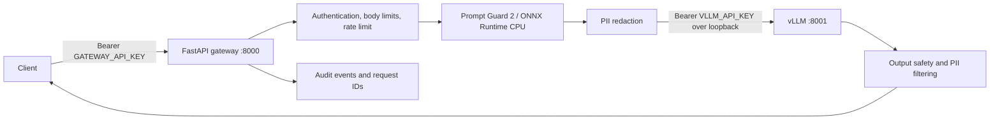

# Secure LLM Deploy

Secure LLM Deploy is a single-container inference service that places an authenticated FastAPI gateway in front of a locally managed vLLM OpenAI-compatible server. It is designed for a single GPU host, with a CPU-only ONNX prompt-injection guard, bounded request handling, PII redaction, output-safety checks, concurrency controls, structured audit events, and build-time-pinned model artifacts.

This README describes the repository's current intended runtime contract. It is not a claim that every build or GPU configuration has been validated: the image build, model initialization, and GPU-backed smoke tests must pass in the target environment before release.

## At a glance

- **Public API:** FastAPI gateway on container port `8000`.
- **Private inference engine:** vLLM on `127.0.0.1:8001`; do not publish or route external traffic to this port.
- **Default mode:** `SERVE_MODE=baseline`.
- **Optional mode:** `SERVE_MODE=speculative`, which enables EAGLE 3.1 speculative decoding using the pinned EAGLE checkpoint.
- **Target model:** `Athithya117/Qwen3-8B-AWQ` at an immutable commit revision.
- **Prompt guard:** `Athithya117/Llama-Prompt-Guard-2-22M-onnx`, run with ONNX Runtime's CPU execution provider.
- **Runtime network behavior:** model artifacts are downloaded during the image build; runtime model loading is configured for offline operation.
- **Authentication:** independent client-facing gateway and internal vLLM API keys, both required and at least 32 characters long.

## Architecture



The gateway is the trust boundary for client traffic. It validates and constrains requests before forwarding them, supervises the vLLM child process, checks readiness, and shapes the response returned to the client. The vLLM API is not intended to be a second public endpoint.

### Startup and process lifecycle

1. The gateway validates runtime settings, required credentials, model files, and cross-field token budgets.
2. The prompt guard is initialized from local files and constrained to `CPUExecutionProvider`.
3. The gateway starts a single vLLM child process, bound to `127.0.0.1`, with request logging disabled and offline model-loading environment variables set.
4. The gateway waits for authenticated `/v1/models` readiness from vLLM. The service is not ready until both the guard and inference process are ready.
5. On shutdown, the gateway closes its upstream HTTP client and terminates the vLLM process group, escalating to a kill if graceful shutdown times out.

The container entrypoint starts one Uvicorn worker. This is deliberate: each gateway process owns a vLLM subprocess and in-memory coordination state. Do not increase `--workers` without redesigning process ownership, GPU allocation, rate limiting, and admission control.

## Model and runtime contract

The source of truth for model identities is `image/model.lock`. It is parsed as data by the image scripts; it must never be sourced or evaluated as shell code. Each model ID is paired with a full immutable 40-character Hugging Face commit revision.

| Role | Repository ID | Pinned revision | Local path |
|---|---|---|---|
| Target model | `Athithya117/Qwen3-8B-AWQ` | `3576ac80a4ea387dbe841fb6c864416e3da45ee0` | `/opt/models/target` |
| EAGLE 3.1 speculator | `Athithya117/Qwen3-8B-from-Qwen3-8B_regen-speculators.eagle31-qwen3arch-ckpt1` | `7d9f0468c1c56a651ab092e5f479f25b4db96f68` | `/opt/models/eagle` |
| Prompt Guard | `Athithya117/Llama-Prompt-Guard-2-22M-onnx` | `4b05eb226761518d4675aa2176c8db9d445b960a` | `/opt/models/guard` |

The image's build-time downloader and validator are expected to reject incomplete or incompatible artifacts. The build pins `vllm/vllm-openai:v0.31.0-cu129@sha256:ff29e51a9457f191deb332b96fa6440584fa941aa2a548449b604e2b1e5e1eeb` and the Dockerfile frontend digest. The target is an AWQ-quantized checkpoint; the vLLM command also specifies `--dtype half` for its runtime compute dtype. That is not the same as describing the checkpoint weights as an unquantized FP16 model. The supplied build target is `linux/amd64`.

The guard's expected ONNX graph is `/opt/models/guard/model.QUInt8.quant.onnx`, with its tokenizer at `tokenizer.json` and class/sequence metadata in `config.json`. Guard inference is CPU-only so it does not compete with target-model inference for GPU memory. The code validates the guard's label mapping instead of assuming a class index means “malicious”.

The EAGLE checkpoint is a speculator, not a separately served user-facing model. In speculative mode, vLLM receives a local `--speculative-config` using method `eagle3`. The pinned EAGLE artifacts include custom `config.py`; because vLLM uses that model configuration, speculative startup involves trusted model code from the pinned, reviewed artifact. Do not change the model revision casually. Baseline mode does not require the EAGLE checkpoint at runtime, but the image build validates and packages the same locked model set.

Changing a model ID, revision, vLLM image digest, tokenizer, ONNX graph, or model validation rule is a supply-chain/runtime-contract change. Review it as code, rebuild from a clean or correctly invalidated cache, inspect the diff and artifact provenance, and run the relevant tests and GPU smoke tests.

## Security design and limits

### Gateway controls

- **Bearer authentication:** `/v1/models` and `/v1/chat/completions` require the gateway key. `/health/live` and `/health/ready` are intentionally unauthenticated for health checks.
- **Request bounding:** the ASGI middleware limits the request body before JSON parsing, including requests without a trustworthy `Content-Length`. Pydantic schemas reject unsupported fields rather than silently accepting them.
- **Rate and concurrency controls:** a bounded sliding-window rate limiter applies per observed client address; separate semaphores bound concurrent guard evaluations and inference requests. These are per-process controls, not a distributed/global quota service.
- **Prompt inspection:** the original prompt is checked by the local ONNX Prompt Guard before PII redaction and before the prompt is sent to vLLM. The guard runs in the same container; prompt classification does not call a remote guard service. Inputs that exceed the full scan budget are rejected rather than accepted on the basis of only a truncated scan.
- **PII handling:** after guard evaluation, messages are redacted before they are forwarded to vLLM. Output handling also applies safety checks and PII filtering, including to streamed responses.
- **Auditability:** each HTTP request receives an `X-Request-ID`. Audit and application logs record endpoint labels, status, duration, security decisions, guard metadata, token-budget metadata, and redaction counts. The application is designed not to log prompt text, completion text, authorization headers, or model tensors.
- **Internal authentication:** the gateway sends a separate vLLM bearer token to its loopback upstream. The child environment is scrubbed of unrelated credential-like variables before the internal key is set. This token is defense in depth, not a reason to expose port `8001`: vLLM API-key protection should not be assumed to cover every internal route, so network isolation and loopback-only binding remain mandatory.
- **Offline runtime model loading:** `HF_HUB_OFFLINE=1` and `TRANSFORMERS_OFFLINE=1` are set for runtime operation. The model-download step is a build-time network operation.
- **Non-root and read-only artifacts:** the image runs as UID `2000`, GID `0`; model files and application files are made read-only. Only explicit temporary cache directories are writable by the runtime user.

### Prompt guard failure policy

`GUARD_FAILURE_POLICY=closed` is the default. Under this policy, a guard inference failure blocks the request with a service-unavailable response rather than pretending the prompt was malicious or silently bypassing the guard. `open` is available as an explicit runtime choice, but it lowers the protection level and must be approved as a risk decision. An input whose length cannot be established safely is not allowed to bypass context/token-budget enforcement.

`GUARD_OVERLONG_POLICY` can be `reject` or `truncate`; the default is `reject`. Regardless of that internal policy setting, the gateway rejects a result that represents only a truncated scan, so a partially scanned prompt cannot authorize forwarding the full original prompt.

### Explicit security limitations

Prompt Guard is a classifier and can produce false positives and false negatives. It is one layer of defense, not a proof that a prompt or model response is safe. PII redaction depends on the redactor's detection patterns and configured sensitive strings; it does not guarantee removal of every sensitive value. Output filtering is not a guarantee against every harmful or policy-violating completion. Audit logs are not a tamper-proof external audit system, and the in-memory rate limiter does not coordinate across replicas. TLS, ingress policy, network segmentation, secret storage/rotation, host hardening, resource limits, and operational monitoring must be supplied by the deployment environment.

The gateway does not trust caller-supplied `X-Forwarded-For` headers for rate-limit identity. Behind a reverse proxy, configure the network path accordingly and understand that the gateway may see the proxy's address as the client identity. Do not enable generic forwarded-header trust without a narrowly configured trusted-proxy design.

## API contract

The gateway exposes a deliberately limited OpenAI-compatible API subset:

| Method and path | Authentication | Purpose |
|---|---|---|
| `GET /health/live` | Public | Process liveness; does not prove the model is ready. |
| `GET /health/ready` | Public | Returns `200` only when the guard is initialized and vLLM is ready/running; otherwise `503`. |
| `GET /v1/models` | Gateway bearer token | Lists the single configured public model name. |
| `POST /v1/chat/completions` | Gateway bearer token | Non-streaming or SSE-streaming chat completions. |

Interactive Swagger/OpenAPI routes are disabled in the application.

The accepted chat-message roles are `system`, `developer`, `user`, and `assistant`. At least one user message is required. The schema supports `temperature`, `top_p`, `max_tokens`, `stop`, `presence_penalty`, `frequency_penalty`, `seed`, `stream`, and `stream_options.include_usage`, with validation. `n` is fixed to `1`; extra request properties and unsupported roles are rejected. This is not a promise of support for every option in the OpenAI API, tools/function calling, multimodal inputs, or arbitrary vLLM endpoints.

Example non-streaming request (replace the key and model field with your configured values):

```bash
curl --fail-with-body --silent --show-error \
  http://127.0.0.1:8000/v1/chat/completions \
  -H "Authorization: Bearer ${GATEWAY_API_KEY}" \
  -H 'Content-Type: application/json' \
  -d '{
    "model": "secure-llm-deploy",
    "messages": [{"role": "user", "content": "Explain why the sky appears blue."}],
    "max_tokens": 128,
    "stream": false
  }'
```

Example streaming request:

```bash
curl --no-buffer --fail-with-body --silent --show-error \
  http://127.0.0.1:8000/v1/chat/completions \
  -H "Authorization: Bearer ${GATEWAY_API_KEY}" \
  -H 'Content-Type: application/json' \
  -d '{
    "model": "secure-llm-deploy",
    "messages": [{"role": "user", "content": "Summarize the water cycle."}],
    "max_tokens": 128,
    "stream": true
  }'
```

These examples are for local smoke testing. Avoid passing real production credentials through shell commands that may be captured by process monitors or shell history. Inject production secrets through the deployment platform's secret-management facility.

## Configuration reference

Values below reflect the current application/configuration defaults. The runtime entrypoint additionally enforces the gateway/vLLM port distinction and requires the internal vLLM host to remain `127.0.0.1`.

### Required secrets

| Variable | Requirement | Purpose |
|---|---|---|
| `GATEWAY_API_KEY` | Required; at least 32 characters; single line | Authenticates clients at the public gateway. |
| `VLLM_API_KEY` | Required; at least 32 characters; single line; must differ from gateway key | Authenticates the gateway to the private vLLM API. |

Generate independent random values. Do not reuse the Hugging Face token, GHCR publishing token, or any other service credential. Do not commit secrets to source control, bake them into image layers, or put them in `image/model.lock`.

### Network and model serving

| Variable | Default | Notes |
|---|---:|---|
| `SERVE_MODE` | `baseline` | `baseline` or `speculative`. |
| `SERVED_MODEL_NAME` | `secure-llm-deploy` | Public model name required in chat requests. |
| `GATEWAY_HOST` | `0.0.0.0` | Gateway bind address inside the container. Restrict exposure at the host/ingress layer. |
| `GATEWAY_PORT` | `8000` | Public gateway port; numeric range `1..65535`. |
| `VLLM_HOST` | `127.0.0.1` | Runtime entrypoint accepts loopback only. |
| `VLLM_PORT` | `8001` | Internal vLLM port; must differ from gateway port. Do not publish it. |
| `VLLM_EXECUTABLE` | `vllm` | Executable resolved from the image `PATH`; must not contain whitespace. |
| `VLLM_MAX_MODEL_LEN` / `MAX_MODEL_LEN` | `4096` | vLLM context length and gateway's total input-plus-output budget ceiling. Prefer `VLLM_MAX_MODEL_LEN`. |
| `VLLM_GPU_MEMORY_UTILIZATION` / `GPU_MEMORY_UTILIZATION` | `0.80` | vLLM GPU memory target, constrained by vLLM and actual hardware. |
| `VLLM_NUM_SPECULATIVE_TOKENS` / `SPECULATIVE_TOKENS` | `2` | Number of EAGLE speculative tokens; used in speculative mode. |
| `VLLM_MAX_NUM_SEQS` | `2` | vLLM sequence concurrency setting. |
| `VLLM_STARTUP_TIMEOUT_SECONDS` | `600` | Seconds allowed for vLLM readiness. |
| `VLLM_STARTUP_POLL_SECONDS` | `2.0` | Poll interval setting for startup-related configuration. |
| `VLLM_CONNECT_TIMEOUT_SECONDS` | `5.0` | Upstream connection timeout. |
| `VLLM_READ_TIMEOUT_SECONDS` | `120.0` | Upstream read timeout. |
| `VLLM_WRITE_TIMEOUT_SECONDS` | `30.0` | Upstream write timeout. |
| `VLLM_POOL_TIMEOUT_SECONDS` | `5.0` | Upstream connection-pool wait timeout. |

### Input, token, and concurrency budgets

| Variable | Default | Purpose |
|---|---:|---|
| `REQUEST_MAX_BODY_BYTES` | `65536` | Maximum HTTP request-body size, enforced before JSON parsing. |
| `MAX_MESSAGES` | `32` | Maximum number of messages in one chat request. |
| `MAX_MESSAGE_CHARS` | `30000` | Character limit for an individual message. |
| `MAX_INPUT_CHARS` | `30000` | Total message-content character budget. |
| `MAX_INPUT_TOKENS` | `3072` | Maximum tokenized prompt budget accepted by the gateway. |
| `DEFAULT_MAX_TOKENS` | `512` | Default generation budget when the request omits `max_tokens`. |
| `MAX_OUTPUT_TOKENS` | `1024` | Maximum allowed requested output-token budget. |
| `RATE_LIMIT_REQUESTS` | `5` | Requests per rate-limit window per observed client address. |
| `RATE_LIMIT_WINDOW_SECONDS` | `60` | Sliding-window duration in seconds. |
| `RATE_LIMIT_MAX_CLIENTS` | `10000` | Bound on tracked client identities. |
| `MAX_CONCURRENT_INFERENCE_REQUESTS` | `2` | Concurrent inference admission limit at the gateway. |
| `MAX_CONCURRENT_GUARD_EVALUATIONS` | `2` | Concurrent prompt-guard evaluation limit. |
| `QUEUE_WAIT_TIMEOUT_SECONDS` | `5.0` | Maximum wait when acquiring guard/inference capacity. |

The application validates token budgets as a combination: input and output must fit within `MAX_MODEL_LEN`, the requested output may not exceed `MAX_OUTPUT_TOKENS`, and the configured input budget must remain below `GUARD_MAX_INPUT_TOKENS`. Do not increase context length or concurrency based solely on a theoretical GPU-memory calculation; validate on the exact GPU, driver, CUDA runtime, vLLM digest, and model artifact set.

### Prompt guard and PII configuration

| Variable | Default | Purpose |
|---|---:|---|
| `GUARD_MODEL_PATH` | `/opt/models/guard/model.QUInt8.quant.onnx` | ONNX graph path. |
| `GUARD_TOKENIZER_PATH` | `/opt/models/guard/tokenizer.json` | Guard tokenizer. |
| `GUARD_CONFIG_PATH` | `/opt/models/guard/config.json` | Guard labels and model metadata. |
| `GUARD_THRESHOLD` | `0.5` | Malicious-class score threshold, `0.0..1.0`. Tune only with evaluation evidence. |
| `GUARD_MAX_INPUT_TOKENS` | `6144` | Maximum guard token budget. |
| `GUARD_WINDOW_TOKENS` | `512` | Maximum sequence window per guard evaluation; constrained by ONNX model contract. |
| `GUARD_INTRA_OP_THREADS` | `2` | ONNX Runtime intra-op CPU threads. |
| `GUARD_FAILURE_POLICY` | `closed` | `closed` or `open`; closed is the safer default. |
| `GUARD_OVERLONG_POLICY` | `reject` | `reject` or `truncate`; gateway rejects partial-scan results. |
| `SENSITIVE_STRINGS` | empty | Optional newline-separated values to redact. Treat this as secret data. |
| `MAX_SENSITIVE_STRING_CHARS` | `1024` | Maximum length for each configured sensitive string. |

The sensitive-string setting accepts up to 100 nonblank lines, each 8 to `MAX_SENSITIVE_STRING_CHARS` characters. Use a secret manager for sensitive values and consider the operational consequences of supplying per-deployment secrets here.

### Model paths and build/runtime paths

| Variable | Default | Notes |
|---|---|---|
| `MODEL_ROOT` | `/opt/models` | Root directory for baked model artifacts. |
| `MODEL_LOCK_FILE` | `/etc/vllm/models.lock` | Read-only copy of `image/model.lock` in the image. |
| `TARGET_MODEL_PATH` | `/opt/models/target` | Target model directory. |
| `TARGET_TOKENIZER_PATH` | `/opt/models/target/tokenizer.json` | Target tokenizer. |
| `EAGLE_MODEL_PATH` | `/opt/models/eagle` | EAGLE checkpoint directory. |
| `HOME` | `/tmp` | Runtime home directory. |
| `HF_HOME` | `/tmp/huggingface` | Runtime Hugging Face cache path. |
| `VLLM_CACHE_ROOT` | `/tmp/vllm-cache` | Temporary vLLM cache. |
| `TORCHINDUCTOR_CACHE_DIR` | `/tmp/torchinductor` | Temporary TorchInductor cache. |
| `HF_HUB_OFFLINE` | `1` | Offline model loading at runtime. |
| `TRANSFORMERS_OFFLINE` | `1` | Offline Transformers behavior at runtime. |

Path overrides are deployment-sensitive. Keep the manifest, downloader, validator, entrypoint, and `Settings` defaults synchronized when changing paths.

## Build the image

Build from the **repository root**, because the Dockerfile copies the root `pyproject.toml`, `uv.lock`, and `README.md` and accesses scripts under `image/`.

```bash
docker buildx build \
  --platform linux/amd64 \
  --load \
  --file image/Dockerfile \
  --tag secure-llm-deploy:local \
  .
```

The Dockerfile pins the vLLM base image by version and digest and pins its Dockerfile frontend. It prepares the gateway's Python environment from `pyproject.toml` and `uv.lock`, downloads model artifacts using immutable revisions from `image/model.lock`, validates the artifacts locally, and then installs the gateway source. BuildKit caching is arranged so ordinary gateway-source edits need not invalidate the multi-gigabyte model-download layer.

**The dependency lock must be present and synchronized.** The build uses `uv sync --locked`; a missing or stale `uv.lock` is a build failure by design. After an intentional dependency change, regenerate and review the lock in the repository, run the tests and static checks, and commit both `pyproject.toml` and `uv.lock` together.

The public repositories currently listed in `image/model.lock` do not normally need an access token. If the chosen repositories require authorization, pass a token using a BuildKit secret; do not use a Docker `ARG`, `ENV`, URL, or copied token file inside the image:

```bash
docker buildx build \
  --platform linux/amd64 \
  --load \
  --file image/Dockerfile \
  --secret id=hf_token,src="$HOME/.cache/huggingface/token" \
  --tag secure-llm-deploy:local \
  .
```

Protect the token source file and keep it outside Git. The build secret is mounted only for the download step. The final image should not contain the token.

## Run locally

The host needs Docker, a compatible NVIDIA driver, NVIDIA Container Toolkit, and sufficient GPU memory for the selected model and runtime configuration. The CPU guard alone does not remove the target model's GPU requirement.

Create a local, untracked env file with independently generated keys, for example:

```dotenv
GATEWAY_API_KEY=<random-secret-at-least-32-characters>
VLLM_API_KEY=<different-random-secret-at-least-32-characters>
SERVE_MODE=baseline
```

Restrict file permissions and do not commit it. Then run the baseline mode with the gateway published only on the host loopback interface:

```bash
chmod 600 .env.local
docker run --rm --gpus all \
  --env-file .env.local \
  -p 127.0.0.1:8000:8000 \
  --name secure-llm-deploy \
  secure-llm-deploy:local
```

For speculative mode, set `SERVE_MODE=speculative` in the environment file and restart the container. The image is the same; the vLLM startup command changes at runtime. Do not map port `8001` to the host.

Check readiness and liveness in another terminal:

```bash
curl --fail-with-body --silent --show-error http://127.0.0.1:8000/health/live
curl --fail-with-body --silent --show-error http://127.0.0.1:8000/health/ready
```

Readiness may remain `503` while the GPU model is loading. A `200` from liveness only confirms the gateway responds; it does not establish inference readiness.

## Smoke tests

The project smoke-test script at `scripts/smoke-tests.sh` exercises the container rather than merely importing Python modules. Use a machine with a working NVIDIA runtime and enough memory to initialize the selected mode.

```bash
SERVE_MODE=baseline ./scripts/smoke-tests.sh
SERVE_MODE=speculative ./scripts/smoke-tests.sh
SERVE_MODE=both ./scripts/smoke-tests.sh
```

Typical overrides documented by the script include:

```bash
IMAGE=secure-llm-deploy:local \
SMOKE_STARTUP_TIMEOUT=1200 \
SERVE_MODE=both \
./scripts/smoke-tests.sh
```

The intended smoke-test coverage includes container readiness/liveness, gateway authentication, model listing, non-streaming completion, streaming SSE termination, and a synthetic prompt-injection attempt. Follow the script's own `--help`/source for the authoritative list of options in the checkout you are testing. Disabling the synthetic guard test may help diagnose a failure, but it is not a complete security smoke test. Unit tests, static analysis, and a successful image build do not prove that GPU model startup or generation will succeed on every driver/GPU combination.

## Developer workflow

Python package metadata and pinned direct dependencies are defined in `pyproject.toml`; reproducible installation is governed by the committed `uv.lock`. The package source is under `image/src/secure_llm_deploy/`, with unit tests under `tests/`.

After installing `uv` and synchronizing the locked development environment, typical checks are:

```bash
uv lock --check
uv sync --locked
uv run pytest
uv run ruff check .
uv run ruff format --check .
uv run mypy
```

Run the commands from the repository root. The exact checks enforced by CI are defined in the workflow files in the checkout; update documentation if those commands change. Unit/API tests may mock GPU and model-dependent dependencies, so distinguish those results from integration and GPU smoke-test results.

Important change-control rules:

1. Treat changes to `pyproject.toml` and `uv.lock` as one reviewed change.
2. Treat model IDs/revisions and model validation behavior as supply-chain changes.
3. Keep configuration defaults synchronized across `config.py`, the image Dockerfile, `entrypoint.sh`, downloader/validator scripts, smoke tests, and this README.
4. Do not weaken guard behavior, request limits, image scanning, signing, provenance, or dependency pinning merely to make CI pass. Investigate and document any intentional policy change.

## Release and image provenance

The intended release artifact is the immutable image digest in `ghcr.io/athithya-sakthivel/secure-llm-deploy`, not a mutable tag alone. The release workflow should build the root context with `image/Dockerfile`, target `linux/amd64`, scan the exact image digest with the configured vulnerability threshold, produce an SBOM and provenance, sign the image with the repository's approved Cosign identity, and verify the emitted metadata before treating the release as deployable. Confirm the actual workflow in `.github/workflows/release.yaml` before relying on any step; this README is not itself evidence that a particular workflow run passed.

The release workflow is documented as using these repository secrets; confirm the current workflow's login step and permissions before creating or rotating them:

- `GHCR_USER_NAME`: lowercase registry publishing namespace.
- `GHCR_PAT`: registry publishing token with the minimum required package-write permission.

Check the current workflow permissions and registry login method before creating or rotating credentials. Registry publishing credentials are unrelated to runtime API keys and Hugging Face download credentials. Never pass them as model IDs, Docker build arguments, runtime environment variables, or image labels.

Before deploying a release, record the full image digest and verify the expected image signature and provenance identity using the tooling and identity constraints configured by the project. An SBOM or attestation existing is not the same as its signature, subject digest, issuer, signer identity, and predicate having been verified.

## Troubleshooting

| Symptom | Likely areas to check |
|---|---|
| Build stops at `uv sync --locked` | `uv.lock` is absent or out of sync with `pyproject.toml`; regenerate it intentionally and commit the result. |
| Model download fails | Build network/DNS, pinned revision accessibility, disk space, Hugging Face authorization, or secret-mount configuration. |
| Build-time artifact validation fails | Compare the downloaded file set and model config with the pinned revision; do not bypass the validator without understanding the contract failure. |
| Container exits immediately | Check required API keys, distinct-key requirement, `SERVE_MODE`, port values, manifest presence, and the first entrypoint/startup error. |
| Liveness is `200` but readiness is `503` | Inspect gateway logs for guard initialization or vLLM startup/readiness failures. |
| Baseline works but speculative mode fails | Confirm the EAGLE files/config match the locked revision, and check the pinned vLLM version's EAGLE 3.1 compatibility and GPU memory. |
| Out-of-memory during startup/inference | Reduce context, concurrent sequences, or memory utilization only after reviewing measured behavior; retest baseline and speculative modes independently. |
| Requests return `401` | Send exactly one `Authorization: Bearer <GATEWAY_API_KEY>` header using the gateway key, not `VLLM_API_KEY`. |
| Requests return `403` | The prompt guard classified the prompt as malicious. Inspect only the request ID and approved audit metadata; do not log or copy sensitive prompt text into general logs. |
| Requests return `413` | A body, character, guard, input-token, or combined input/output context limit was exceeded. |
| Requests return `429` | Per-observed-client rate limit exceeded; check reverse-proxy topology and configured rate window. |
| Guard failures return `503` | With the default fail-closed policy, guard infrastructure failures prevent inference. Fix the underlying guard/model issue rather than changing to fail-open as a workaround. |

## Upstream documentation

- [vLLM Docker deployment](https://docs.vllm.ai/en/v0.31.0/deployment/docker/)
- [vLLM speculative decoding examples](https://docs.vllm.ai/en/v0.31.0/examples/features/speculative_decoding/)
- [vLLM serve arguments and API-key options](https://docs.vllm.ai/en/v0.31.0/configuration/serve_args/)
- [Docker BuildKit build secrets](https://docs.docker.com/build/building/secrets/)
- [GitHub Container Registry](https://docs.github.com/en/packages/working-with-a-github-packages-registry/working-with-the-container-registry)
- [GitHub artifact attestations](https://docs.github.com/en/actions/how-tos/secure-your-work/use-artifact-attestations)
- [GitHub CLI attestation verification](https://cli.github.com/manual/gh_attestation_verify)
- [Cosign container signature verification](https://docs.sigstore.dev/cosign/verifying/verify/)
- [Trivy GitHub Action](https://github.com/aquasecurity/trivy-action)

## License and model terms

Review the repository's software license and the model cards/licenses for all three pinned model repositories before redistribution or commercial deployment. The container image's license does not replace the licenses or acceptable-use terms of its included model artifacts.
